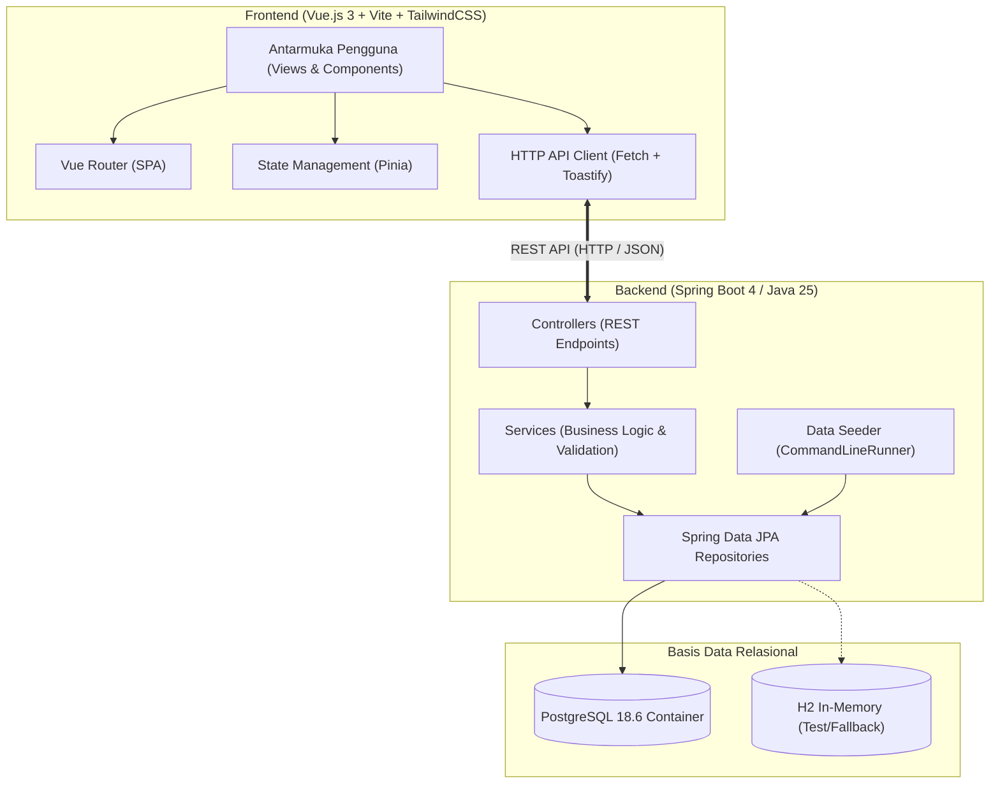
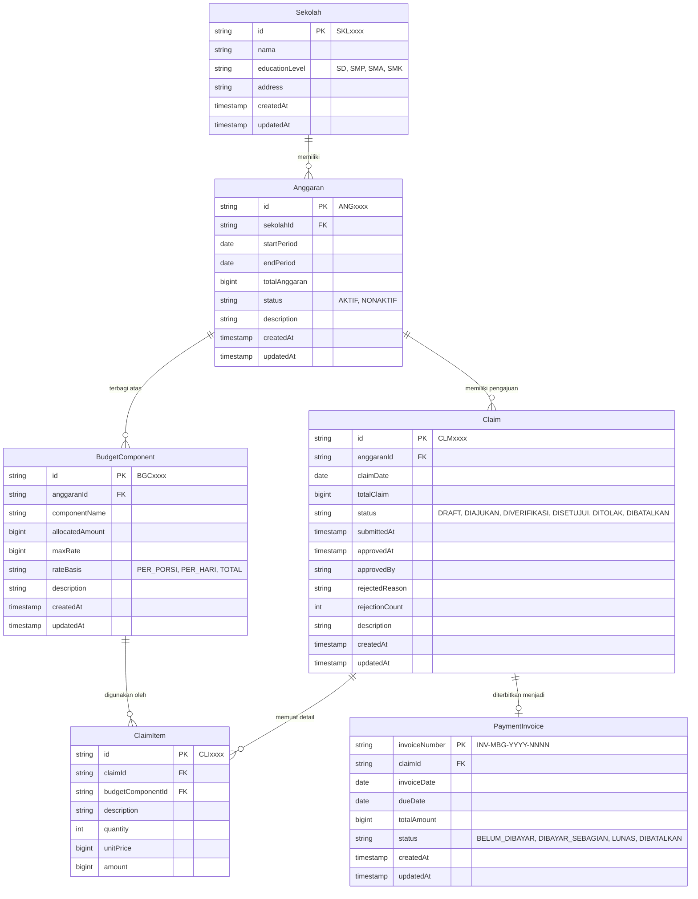

# SIMBG - Modul MBG5: Anggaran dan Tagihan

**Tugas Individu Pemrograman dan Aplikasi Perusahaan (APAP)**  
**Semester Gasal 2026/2027 - Fasilkom Universitas Indonesia**

- **Nama:** Freya Zahra Anindyabhakti  
- **NPM:** 2406349285  
- **Modul:** MBG5 (Anggaran dan Tagihan)  

---

## 1. Deskripsi Proyek

Sistem Informasi Makan Bergizi Gratis (SIMBG) dirancang untuk mengintegrasikan seluruh rantai proses program makan bergizi nasional. Modul **MBG5 (Anggaran dan Tagihan)** bertanggung jawab atas pengelolaan pagu anggaran sekolah, pemecahan komponen belanja (*Budget Component*), pencatatan dan verifikasi pengajuan klaim biaya (*Claim* & *ClaimItem*), penerbitan tagihan (*PaymentInvoice*), serta analisis statistik serapan dan realisasi anggaran.

---

## 2. Arsitektur Sistem

Aplikasi ini menggunakan pendekatan arsitektur berlapis (*layered architecture*) decoupled modern antara frontend Single Page Application (SPA) dan backend REST API:



---

## 3. Desain Basis Data (ERD)



---

## 4. Aturan Bisnis & Validasi (Business Rules)

1. **Alokasi Pagu Anggaran:**
   $$\sum \text{allocatedAmount (Budget Component)} \le \text{totalAnggaran}$$
   Setiap penambahan atau pembaruan komponen anggaran tidak boleh menyebabkan total alokasi melebihi pagu anggaran periode tersebut.
2. **Plafon Tarif Komponen (*Max Rate*):**
   $$\text{unitPrice (ClaimItem)} \le \text{maxRate (BudgetComponent)}$$
3. **Batas Klaim per Komponen:**
   $$\sum \text{amount (ClaimItem)} \le \text{allocatedAmount (BudgetComponent)}$$
4. **Alur Status Klaim (*State Machine*):**
   - `DRAFT` $\rightarrow$ `DIAJUKAN` (wajib memiliki minimal 1 ClaimItem)
   - `DIAJUKAN` $\rightarrow$ `DIVERIFIKASI`
   - `DIVERIFIKASI` $\rightarrow$ `DISETUJUI` (wajib mengisi `approvedBy`)
   - `DIVERIFIKASI` $\rightarrow$ `DITOLAK` (wajib mengisi `rejectedReason`, mencatat `rejectionCount`)
   - `DITOLAK` $\rightarrow$ `DIAJUKAN` (maksimal 3 kali pengajuan ulang)
   - `DRAFT` / `DIAJUKAN` $\rightarrow$ `DIBATALKAN`
5. **Penerbitan Invoice:**
   - Hanya dapat diterbitkan untuk klaim yang berstatus `DISETUJUI`.
   - Satu klaim hanya dapat memiliki 1 invoice.
   - `dueDate` harus lebih besar dari `invoiceDate`.

---

## 5. Dokumentasi API (Endpoints)

Format Response Standar:
```json
{
  "status": 200,
  "message": "Success",
  "timestamp": "2026-10-01T00:51:35.154+07:00",
  "data": ...
}
```

| No | Method | Endpoint | Deskripsi |
|---|---|---|---|
| 1 | GET | `/home` | Ringkasan metrik dashboard utama |
| 2 | GET | `/sekolah` | Daftar seluruh sekolah |
| 3 | GET | `/anggaran` | Daftar seluruh anggaran sekolah |
| 4 | POST | `/anggaran` | Tambah anggaran baru |
| 5 | GET | `/anggaran/{id}` | Detail anggaran beserta alokasi |
| 6 | GET | `/anggaran/{anggaranId}/komponen` | Daftar komponen anggaran |
| 7 | GET | `/anggaran/{anggaranId}/komponen/{id}` | Detail komponen anggaran |
| 8 | POST | `/anggaran/{anggaranId}/komponen` | Tambah komponen anggaran baru |
| 9 | PUT | `/anggaran/{anggaranId}/komponen/{id}` | Ubah data komponen anggaran |
| 10 | GET | `/claim` | Daftar seluruh klaim |
| 11 | POST | `/claim` | Buat draft klaim baru |
| 12 | GET | `/claim/{id}` | Detail informasi klaim dan item |
| 13 | PUT | `/claim/{id}` | Ubah data draft klaim |
| 14 | PATCH | `/claim/{id}/status` | Transisi status klaim |
| 15 | GET | `/claim/{claimId}/item` | Daftar item belanja klaim |
| 16 | GET | `/claim/{claimId}/item/{id}` | Detail item belanja klaim |
| 17 | POST | `/claim/{claimId}/item` | Tambah item belanja klaim |
| 18 | PUT | `/claim/{claimId}/item/{id}` | Ubah item belanja klaim |
| 19 | GET | `/invoice` | Daftar invoice pembayaran |
| 20 | POST | `/invoice` | Terbitkan invoice dari klaim disetujui |
| 21 | GET | `/invoice/{invoiceNumber}` | Detail invoice beserta rincian item |
| 22 | GET | `/invoice/statistik` | Statistik status klaim & tren bulanan invoice |

Contoh isi `data` untuk endpoint dashboard:
```json
{
  "jumlahSekolah": 10,
  "totalAnggaran": 320000000,
  "jumlahAnggaran": 4,
  "jumlahClaim": 11,
  "totalNominalClaim": 892000,
  "jumlahInvoice": 4,
  "totalNominalInvoice": 861000
}
```

Setiap item pada `GET /sekolah` memuat `id`, `nama`, `educationLevel`, `address`,
`createdAt`, `updatedAt`, `activeAnggaranCount`, dan `activeAnggaranTotal`.
`activeAnggaranCount` serta `activeAnggaranTotal` hanya menghitung anggaran
dengan status `AKTIF`.

---

## 6. Panduan Instalasi dan Menjalankan Proyek

### Prasyarat
- Java JDK 25
- Node.js v22+ / v24+
- Docker & Docker Compose

### 1. Menjalankan Basis Data (Docker)
Jalankan container PostgreSQL melalui perintah:
```bash
docker compose up -d
```
Basis data akan berjalan pada port `15432` dengan kredensial `simbg / simbg`.

### 2. Menjalankan Back End (Spring Boot)
Masuk ke direktori `simbg-2406349285-be`:
```bash
cd simbg-2406349285-be

# Menjalankan aplikasi
./gradlew bootRun

# Menjalankan unit test
./gradlew test

# Membangun file JAR mandiri
./gradlew bootJar
```
Back End berjalan pada: `http://localhost:8080`.  
Untuk menjalankan JAR yang sudah dibangun, jalankan dari folder `simbg-2406349285-be` agar file `.env` terbaca:
```bash
cd simbg-2406349285-be
java -jar ../MBG52406349285.jar
```
Data seeder otomatis mengisi data awal yang konsisten dengan spesifikasi soal.

### 3. Menjalankan Front End (Vue.js)
Masuk ke direktori `simbg-2406349285-fe`:
```bash
cd simbg-2406349285-fe

# Instalasi dependensi
npm install

# Menjalankan server pengembangan
npm run dev

# Membangun berkas produksi
npm run build
```
Front End dapat diakses melalui browser pada: `http://localhost:5173`.
