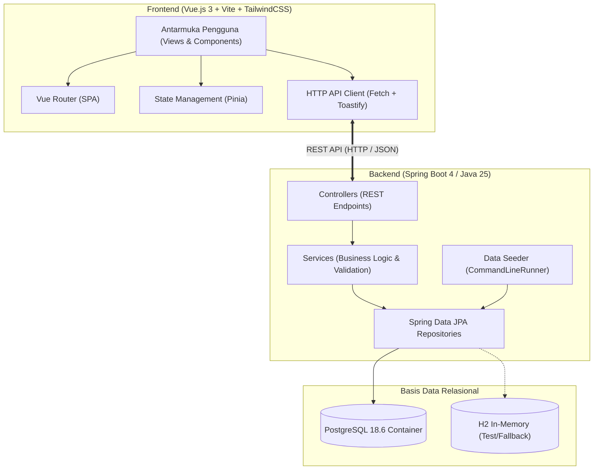
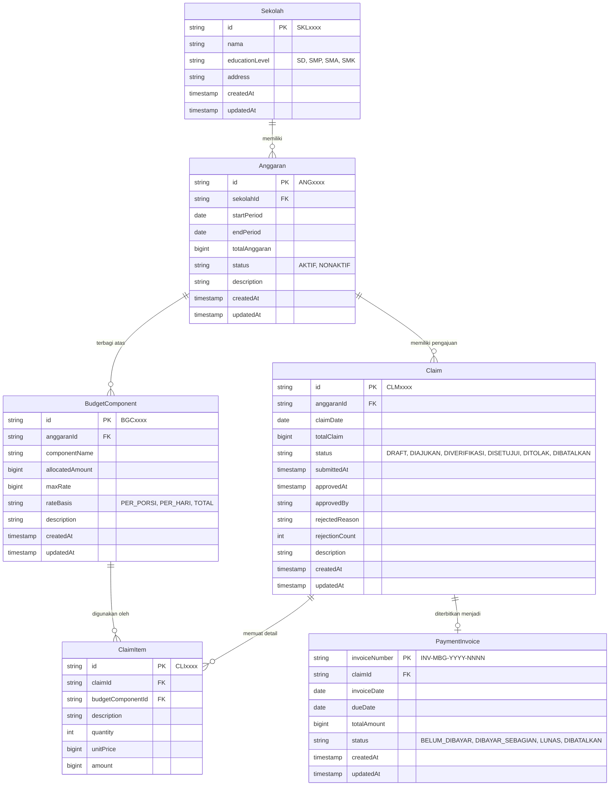

# SIMBG - Modul MBG5: Anggaran dan Tagihan

**Tugas Individu Pemrograman dan Aplikasi Perusahaan (APAP)**  
**Semester Gasal 2026/2027 - Fasilkom Universitas Indonesia**

- **Nama:** Freya Zahra Anindyabhakti  
- **NPM:** 2406349285  
- **Kelas:** A
- **Modul:** MBG5 (Anggaran dan Tagihan)  

---

## Deployment Docker dan GitLab CI/CD

> **Status:** petunjuk dan placeholder berikut merupakan draf. Isi data AWS,
> GitLab, Docker Hub, serta tangkapan layar setelah deployment benar-benar berhasil.

### Ringkasan persiapan

- VM AWS EC2 Ubuntu 26.04 LTS dengan tipe `t2.medium` telah dibuat dan
  Docker serta Docker Compose telah dipasang.
- Firewall Security Group telah dikonfigurasi untuk port 22, 80, 8080, 8081,
  13000, dan 19090; Elastic IP telah dialokasikan dan dipasang ke VM.
- `Dockerfile` multistage untuk backend dan frontend serta konfigurasi Nginx
  untuk SPA dan proxy API telah dibuat.
- `docker-compose.yaml` dan konfigurasi Prometheus telah disiapkan; container
  PostgreSQL, Prometheus, dan Grafana telah dijalankan di VM.
- Skrip `.gitlab-ci.yml` telah disiapkan untuk build image dengan Buildah dan
  deployment melalui SSH. Pipeline dan deployment aplikasi belum diverifikasi
  karena GitLab tidak dapat diakses pada waktu pengumpulan.

Repositori ini berisi **satu** backend Spring Boot (`simbg-2406349285-be`) dan
satu frontend Vue (`simbg-2406349285-fe`). Contoh `author-app` dan `library-app`
di panduan praktikum merupakan aplikasi lain dan tidak ada di repositori ini.
Oleh karena itu pipeline membangun dua image yang memang tersedia, bukan tiga
image contoh. Backend mendengarkan port 8080; frontend dilayani Nginx pada port
80. Nginx juga meneruskan `/api/` ke backend melalui jaringan Docker sehingga
browser tidak memanggil `localhost` milik pengguna.

### 1. Prasyarat dan penyiapan VM AWS

1. Siapkan akses AWS, proyek GitLab praktikum di
   `https://gitlab.cs.ui.ac.id/apap-gasal-2026-2027/praktikum-7/2406349285`,
   akun Docker Hub, dan akses untuk membuat runner GitLab.
2. Di AWS EC2, buat instance deployment Ubuntu Server 26.04 LTS dengan
   arsitektur **x86_64/amd64**. Pilih ukuran dan kapasitas disk yang cukup untuk
   Java, Docker, PostgreSQL, dan monitoring; perhatikan kuota dan biaya AWS.
   Buat/download key pair `.pem`, simpan di luar repositori, dan gunakan
   `chmod 400 /path/ke/key.pem` di komputer lokal.
3. Alokasikan **Elastic IP** di region yang sama, lalu associate ke instance.
   Catat sebagai `<ELASTIC_IP>`. Elastic IP dan instance aktif dapat dikenai biaya.
4. Atur inbound **Security Group**:
   - TCP 22: hanya IP publik komputer pengelola dan IP publik runner. Jika
     keduanya dalam VPC yang sama, akses runner dapat dibatasi melalui security
     group runner. Jangan membuka SSH ke seluruh internet.
   - TCP 80: `0.0.0.0/0` agar aplikasi dapat dibuka publik.
   - TCP 15432, 19090, dan 13000: hanya IP pengelola yang benar-benar
     membutuhkan akses; jangan buka PostgreSQL atau dashboard ke publik.
     Tidak perlu membuka 8080 karena backend diakses lewat jaringan Docker.
   - Jika UFW atau firewall host aktif, terapkan pembatasan yang setara dan
     verifikasi aturan Docker: port Docker yang dipublikasikan dapat melewati
     aturan UFW biasa. Security Group tetap menjadi pembatas utama.
5. Hubungkan ke VM, ganti placeholder dengan nilai sebenarnya:

   ```bash
   ssh -i /path/ke/key.pem ubuntu@<ELASTIC_IP>
   ```

### 2. Instal Docker pada VM deployment

Perintah berikut untuk Ubuntu. Jalankan di VM, lalu buka sesi SSH baru agar
keanggotaan grup `docker` berlaku:

```bash
sudo apt-get update
sudo apt-get install -y ca-certificates curl git
sudo install -m 0755 -d /etc/apt/keyrings
sudo curl -fsSL https://download.docker.com/linux/ubuntu/gpg -o /etc/apt/keyrings/docker.asc
sudo chmod a+r /etc/apt/keyrings/docker.asc
echo "deb [arch=$(dpkg --print-architecture) signed-by=/etc/apt/keyrings/docker.asc] https://download.docker.com/linux/ubuntu $(. /etc/os-release && echo "$VERSION_CODENAME") stable" | sudo tee /etc/apt/sources.list.d/docker.list > /dev/null
sudo apt-get update
sudo apt-get install -y docker-ce docker-ce-cli containerd.io docker-buildx-plugin docker-compose-plugin
sudo systemctl enable --now docker
sudo usermod -aG docker "$USER"
exit
```

Masuk lagi dengan SSH dan periksa `docker version` serta
`docker compose version`. Keanggotaan grup Docker memberikan akses setara root;
gunakan hanya untuk akun tepercaya. `curl` dibutuhkan untuk pemeriksaan
kesiapan oleh skrip deployment.

### 3. Jalankan layanan infrastruktur di VM

1. Clone repositori GitLab ke VM, atau salin `docker-compose.yaml` dan
   `prometheus.yaml` ke direktori yang sama. Contoh:

   ```bash
   git clone <URL_REPOSITORI_GITLAB> simbg
   cd simbg
   ```

2. Buat berkas `.env` **di direktori ini pada VM**, bukan di GitLab. Contoh
   isinya (ganti kedua password dengan nilai kuat dan unik):

   ```dotenv
   POSTGRES_DB=simbg
   POSTGRES_USER=simbg
   POSTGRES_PASSWORD=<PASSWORD_POSTGRES_KUAT>
   GRAFANA_ADMIN_USER=admin
   GRAFANA_ADMIN_PASSWORD=<PASSWORD_GRAFANA_KUAT>
   ```

   Jalankan `chmod 600 .env`. Berkas `.env` di root sudah diabaikan Git.
   Compose memakai named volume lokal untuk data PostgreSQL, Prometheus, dan
   Grafana; jangan menjalankan `docker compose down -v` jika data harus tetap
   tersimpan. Password dan nama database PostgreSQL hanya diterapkan saat
   volume pertama kali diinisialisasi: mengubah `.env` saja tidak mengubah
   kredensial database yang sudah ada.
3. Jalankan dan periksa layanan:

   ```bash
   docker compose config --quiet
   docker compose up -d
   docker compose ps
   docker network inspect apap-network
   ```

   Tunggu PostgreSQL berstatus `healthy`. Port host PostgreSQL adalah 15432,
   Prometheus 19090, dan Grafana 13000. Prometheus hanya mengumpulkan metrik
   dirinya sendiri dalam konfigurasi awal; belum ada metrik Spring Boot.
   Jika akses monitoring diizinkan firewall, buka
   `http://<ELASTIC_IP>:19090` dan `http://<ELASTIC_IP>:13000`. Di Grafana,
   login dengan kredensial `.env` dan tambahkan data source Prometheus dengan
   URL `http://prometheus:9090`.

### 4. Docker Hub dan konfigurasi GitLab

1. Buat dua repositori Docker Hub bernama `simbg-backend` dan
   `simbg-frontend` di bawah akun Anda. Buat access token Docker Hub yang dapat
   melakukan push dan pull; simpan di GitLab, bukan dalam source code.
2. Siapkan key SSH khusus deployment. Public key harus berada di
   `~ubuntu/.ssh/authorized_keys` pada VM; private key tetap rahasia dan
   berbeda dari key pair AWS jika memungkinkan. Pastikan pengguna deployment
   dapat menjalankan Docker tanpa `sudo` dan dapat memakai `curl`.
3. Pastikan host key SSH VM asli: pada VM jalankan
   `ssh-keygen -lf /etc/ssh/ssh_host_ed25519_key.pub`. Dari mesin tepercaya,
   ambil baris dengan `ssh-keyscan -t ed25519 <ELASTIC_IP> > known_hosts`,
   lalu bandingkan fingerprint `ssh-keygen -lf known_hosts` dengan fingerprint
   yang diperoleh langsung dari VM. Gunakan hanya baris yang sudah diverifikasi
   sebagai nilai `SSH_KNOWN_HOSTS`; jangan menonaktifkan verifikasi host key.
4. Di GitLab, buka **Settings > CI/CD > Variables** dan buat variabel berikut.
   Set semua variabel sebagai **Protected**, lindungi default branch, dan
   aktifkan **Masked** untuk rahasia jika nilai memenuhi aturan masking GitLab.
   Untuk variabel bertipe File, isi dengan konten file, bukan nama path lokal.

   | Variabel | Jenis | Contoh / isi |
   | --- | --- | --- |
   | `DOCKERHUB_USERNAME` | Variable | nama akun Docker Hub |
   | `DOCKERHUB_TOKEN` | Variable, rahasia | token push/pull Docker Hub |
   | `DEPLOY_HOST` | Variable | Elastic IP VM deployment |
   | `DEPLOY_USER` | Variable | `ubuntu` |
   | `SSH_PRIVATE_KEY` | File, rahasia | isi private key deployment, termasuk newline terakhir |
   | `SSH_KNOWN_HOSTS` | File | isi `known_hosts` yang sudah diverifikasi |
   | `DB_URL` | Variable | `jdbc:postgresql://simbg-postgres:5432/simbg` |
   | `DB_USERNAME` | Variable | sama dengan `POSTGRES_USER` di VM |
   | `DB_PASSWORD` | Variable, rahasia | sama dengan `POSTGRES_PASSWORD` di VM |
   | `ALLOWED_ORIGINS` | Variable | `http://<ELASTIC_IP>`; pisahkan beberapa origin dengan koma |

   `DB_URL` menggunakan port **5432 internal Docker**, bukan port 15432 host.
   Image menggunakan `/api` sebagai URL API saat build, dan Nginx meneruskan
   permintaan ke `simbg-backend:8080`. `ALLOWED_ORIGINS` juga dikonsumsi oleh
   konfigurasi CORS backend; untuk akses lewat domain, gunakan origin domain
   yang tepat. Secara default lokal backend tetap menerima semua origin.
   Nilai yang memuat karakter khusus di `.env` Compose harus mengikuti aturan
   quoting/interpolasi Compose; pastikan nilai di GitLab benar-benar sama.

   **Penting:** `simbg-2406349285-be/.env` pernah terlacak dalam riwayat Git
   meskipun sudah dihapus dari tracking. Jangan menaruh password deployment di
   sana. Jika file tersebut pernah berisi kredensial nyata, anggap sudah
   terpapar, segera rotasi kredensial dan tangani riwayat Git sesuai kebijakan
   proyek.

### 5. Daftarkan GitLab Runner

Gunakan runner tepercaya; sebaiknya buat VM Ubuntu **terpisah** dari VM
deployment, seperti saran suplemen. Pastikan runner dapat menjangkau GitLab,
Docker Hub, registry image, dan SSH VM deployment. Instal Docker pada VM runner
seperti langkah 2. Lalu instal GitLab Runner menggunakan repositori resmi:

```bash
curl -fsSL https://packages.gitlab.com/install/repositories/runner/gitlab-runner/script.deb.sh -o /tmp/install-gitlab-runner.sh
sudo bash /tmp/install-gitlab-runner.sh
sudo apt-get install -y gitlab-runner
```

1. Di GitLab buka **Settings > CI/CD > Runners**, pilih **Create project
   runner**, izinkan menjalankan untagged jobs, dan buat runner. Simpan token
   autentikasi yang ditampilkan secara rahasia.
2. Pada VM runner, jalankan perintah registrasi yang diberikan GitLab:

   ```bash
   sudo gitlab-runner register --url https://gitlab.cs.ui.ac.id --token <TOKEN_RUNNER>
   ```

   Pilih executor `docker` dan default image misalnya `alpine:3.23.4`.
   Masing-masing job pipeline menggunakan image yang didefinisikan sendiri.
3. Untuk Buildah pada Docker executor, edit
   `/etc/gitlab-runner/config.toml` pada bagian `[runners.docker]` runner
   tersebut dan atur `privileged = true`, lalu jalankan
   `sudo systemctl restart gitlab-runner`. Privileged runner berisiko tinggi:
   gunakan runner khusus untuk proyek tepercaya, lindungi runner, dan jangan
   menjalankan pipeline dari kode yang tidak dipercaya.
4. Pastikan status runner online di GitLab dan runner boleh menjalankan job pada
   default branch yang dilindungi. Jika menggunakan runner bersama, pastikan
   runner tersebut mendukung Buildah; konfigurasi privileged-nya dikelola
   administrator runner.

### 6. Jalankan pipeline dan verifikasi

1. Push perubahan ke **default branch yang dilindungi** sesuai aturan akses
   GitLab. Pipeline hanya berjalan pada default branch: dua job `build`
   menggunakan Buildah dan mem-push image ber-tag commit SHA ke Docker Hub;
   setelah keduanya sukses job `deploy` menggunakan SSH.
2. Di **Build > Pipelines**, periksa log kedua build dan deployment. Deploy
   menarik kedua image sebelum menghapus kontainer aplikasi lama, menjalankan
   backend dan frontend pada `apap-network`, dan menunggu `/api/home`
   merespons. Deployment bisa menyebabkan downtime dan tidak melakukan rollback
   otomatis; data volume infrastruktur tidak dihapus.
3. Di VM periksa `docker ps`, `docker logs simbg-backend`,
   `docker logs simbg-frontend`, dan `curl -fsS http://127.0.0.1/api/home`.
   Buka `http://<ELASTIC_IP>/` di browser, coba beberapa fitur yang mengakses
   database, dan refresh halaman selain `/` untuk memeriksa fallback SPA.
4. Jika pipeline gagal, periksa log job, akses runner ke SSH dan Docker Hub,
   status PostgreSQL, nilai CI variables, serta Security Group. Perubahan
   `docker-compose.yaml` atau `prometheus.yaml` harus disalin ke VM dan
   diterapkan kembali dengan `docker compose up -d`; pipeline hanya mengganti
   kontainer aplikasi.

HTTP pada port 80 belum terenkripsi dan aplikasi ini belum disiapkan untuk
penggunaan publik yang aman. Untuk produksi, gunakan domain, HTTPS/TLS, kontrol
akses, backup, dan pengelolaan rahasia yang sesuai; jangan menaruh data sensitif
di instalasi praktikum ini.

### 7. Tangkapan layar hasil deployment

<!-- TODO: Simpan tangkapan layar Anda, lalu ganti path berikut. -->


---

## 1. Deskripsi Proyek

Sistem Informasi Makan Bergizi Gratis (SIMBG) dirancang untuk mengintegrasikan seluruh rantai proses program makan bergizi nasional. Modul **MBG5 (Anggaran dan Tagihan)** bertanggung jawab atas pengelolaan pagu anggaran sekolah, pemecahan komponen belanja (*Budget Component*), pencatatan dan verifikasi pengajuan klaim biaya (*Claim* & *ClaimItem*), penerbitan tagihan (*PaymentInvoice*), serta analisis statistik serapan dan realisasi anggaran.

---

## 2. Arsitektur Sistem

Aplikasi ini menggunakan pendekatan arsitektur berlapis (*layered architecture*) decoupled modern antara frontend Single Page Application (SPA) dan backend REST API:



---

## 3. Desain Basis Data (ERD)



---

## 4. Aturan Bisnis & Validasi (Business Rules)

1. **Alokasi Pagu Anggaran:**
   $$\sum \text{allocatedAmount (Budget Component)} \le \text{totalAnggaran}$$
   Setiap penambahan atau pembaruan komponen anggaran tidak boleh menyebabkan total alokasi melebihi pagu anggaran periode tersebut.
2. **Plafon Tarif Komponen (*Max Rate*):**
   $$\text{unitPrice (ClaimItem)} \le \text{maxRate (BudgetComponent)}$$
3. **Batas Klaim per Komponen:**
   $$\sum \text{amount (ClaimItem)} \le \text{allocatedAmount (BudgetComponent)}$$
4. **Alur Status Klaim (*State Machine*):**
   - `DRAFT` $\rightarrow$ `DIAJUKAN` (wajib memiliki minimal 1 ClaimItem)
   - `DIAJUKAN` $\rightarrow$ `DIVERIFIKASI`
   - `DIVERIFIKASI` $\rightarrow$ `DISETUJUI` (wajib mengisi `approvedBy`)
   - `DIVERIFIKASI` $\rightarrow$ `DITOLAK` (wajib mengisi `rejectedReason`, mencatat `rejectionCount`)
   - `DITOLAK` $\rightarrow$ `DIAJUKAN` (maksimal 3 kali pengajuan ulang)
   - `DRAFT` / `DIAJUKAN` $\rightarrow$ `DIBATALKAN`
5. **Penerbitan Invoice:**
   - Hanya dapat diterbitkan untuk klaim yang berstatus `DISETUJUI`.
   - Satu klaim hanya dapat memiliki 1 invoice.
   - `dueDate` harus lebih besar dari `invoiceDate`.

---

## 5. Dokumentasi API (Endpoints)

Format Response Standar:
```json
{
  "status": 200,
  "message": "Success",
  "timestamp": "2026-10-01T00:51:35.154+07:00",
  "data": ...
}
```

| No | Method | Endpoint | Deskripsi |
|---|---|---|---|
| 1 | GET | `/home` | Ringkasan metrik dashboard utama |
| 2 | GET | `/sekolah` | Daftar seluruh sekolah |
| 3 | GET | `/anggaran` | Daftar seluruh anggaran sekolah |
| 4 | POST | `/anggaran` | Tambah anggaran baru |
| 5 | GET | `/anggaran/{id}` | Detail anggaran beserta alokasi |
| 6 | GET | `/anggaran/{anggaranId}/komponen` | Daftar komponen anggaran |
| 7 | GET | `/anggaran/{anggaranId}/komponen/{id}` | Detail komponen anggaran |
| 8 | POST | `/anggaran/{anggaranId}/komponen` | Tambah komponen anggaran baru |
| 9 | PUT | `/anggaran/{anggaranId}/komponen/{id}` | Ubah data komponen anggaran |
| 10 | GET | `/claim` | Daftar seluruh klaim |
| 11 | POST | `/claim` | Buat draft klaim baru |
| 12 | GET | `/claim/{id}` | Detail informasi klaim dan item |
| 13 | PUT | `/claim/{id}` | Ubah data draft klaim |
| 14 | PATCH | `/claim/{id}/status` | Transisi status klaim |
| 15 | GET | `/claim/{claimId}/item` | Daftar item belanja klaim |
| 16 | GET | `/claim/{claimId}/item/{id}` | Detail item belanja klaim |
| 17 | POST | `/claim/{claimId}/item` | Tambah item belanja klaim |
| 18 | PUT | `/claim/{claimId}/item/{id}` | Ubah item belanja klaim |
| 19 | GET | `/invoice` | Daftar invoice pembayaran |
| 20 | POST | `/invoice` | Terbitkan invoice dari klaim disetujui |
| 21 | GET | `/invoice/{invoiceNumber}` | Detail invoice beserta rincian item |
| 22 | GET | `/invoice/statistik` | Statistik status klaim & tren bulanan invoice |

Contoh isi `data` untuk endpoint dashboard:
```json
{
  "jumlahSekolah": 10,
  "totalAnggaran": 320000000,
  "jumlahAnggaran": 4,
  "jumlahClaim": 11,
  "totalNominalClaim": 892000,
  "jumlahInvoice": 4,
  "totalNominalInvoice": 861000
}
```

Setiap item pada `GET /sekolah` memuat `id`, `nama`, `educationLevel`, `address`,
`createdAt`, `updatedAt`, `activeAnggaranCount`, dan `activeAnggaranTotal`.
`activeAnggaranCount` serta `activeAnggaranTotal` hanya menghitung anggaran
dengan status `AKTIF`.

---

## 6. Panduan Instalasi dan Menjalankan Proyek

### Prasyarat
- Java JDK 25
- Node.js v22+ / v24+
- Docker & Docker Compose

### 1. Menjalankan Basis Data (Docker)
Untuk development lokal, gunakan Compose khusus backend (berbeda dari Compose
infrastruktur VM):
```bash
docker compose -f simbg-2406349285-be/docker-compose.yaml up -d
```
Basis data akan berjalan pada port `15432` dengan kredensial `simbg / simbg`.

### 2. Menjalankan Back End (Spring Boot)
Masuk ke direktori `simbg-2406349285-be`:
```bash
cd simbg-2406349285-be

# Menjalankan aplikasi
./gradlew bootRun

# Menjalankan unit test
./gradlew test

# Membangun file JAR mandiri
./gradlew bootJar
```
Back End berjalan pada: `http://localhost:8080`.  
Untuk menjalankan JAR yang sudah dibangun, jalankan dari folder `simbg-2406349285-be` agar file `.env` terbaca:
```bash
cd simbg-2406349285-be
java -jar ../MBG52406349285.jar
```
Data seeder otomatis mengisi data awal yang konsisten dengan spesifikasi soal.

### 3. Menjalankan Front End (Vue.js)
Masuk ke direktori `simbg-2406349285-fe`:
```bash
cd simbg-2406349285-fe

# Instalasi dependensi
npm install

# Menjalankan server pengembangan
npm run dev

# Membangun berkas produksi
npm run build
```
Front End dapat diakses melalui browser pada: `http://localhost:5173`.

---

**Catatan:** Tangkapan layar hasil deployment ke VM AWS tidak dapat dilampirkan saat ini karena server GitLab CSUI sedang mengalami downtime pada waktu pengumpulan, sehingga pipeline CI/CD tidak dapat dieksekusi.
